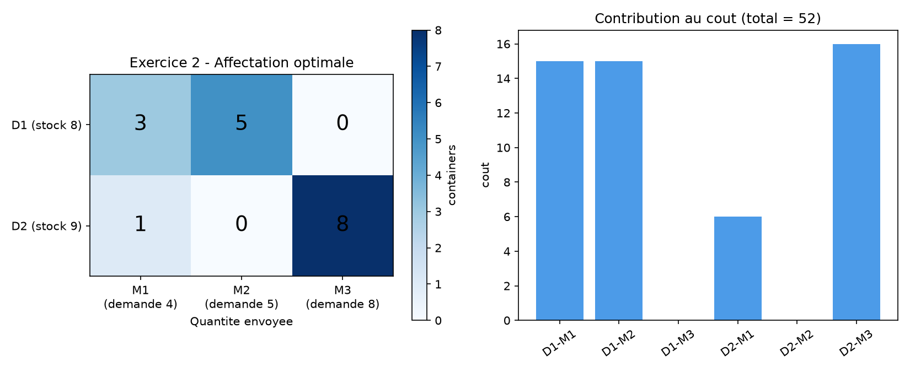
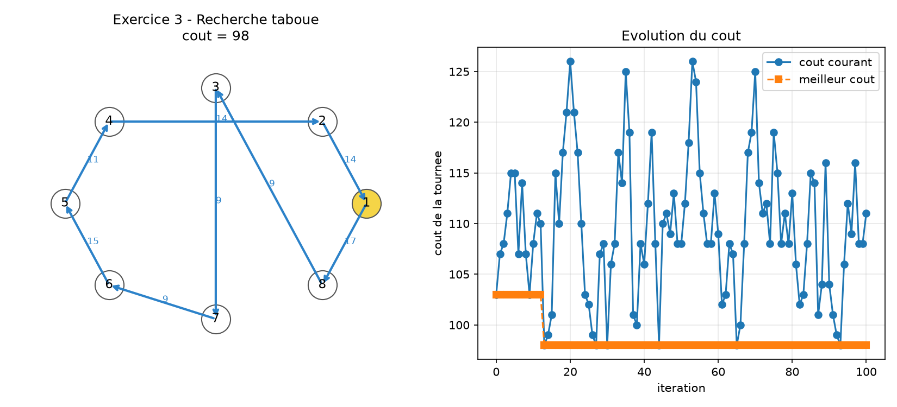
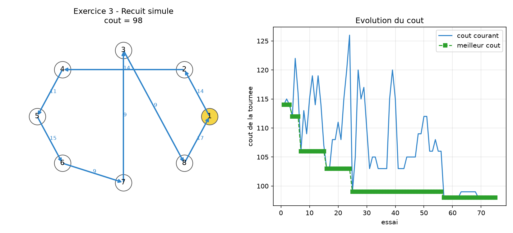

# 🔎 TD2 - Recherche operationnelle

Ce depot contient mon travail du TD2. Les programmes sont ecrits en Python.

| Exercice | Probleme | Methode |
|---|---|---|
| 2 | Transport depots -> magasins | Recherche taboue |
| 3 | Voyageur de commerce (8 villes) | Recherche taboue et recuit simule |

L'algorithme genetique n'est pas inclus car le message de l'enseignante demande
uniquement le recuit simule et la recherche taboue pour l'exercice 3.

## Fichiers

- `exercice2_transport.py` : probleme de transport avec recherche taboue ;
- `exercice3_tabou.py` : voyageur de commerce avec recherche taboue ;
- `exercice3_recuit_simule.py` : voyageur de commerce avec recuit simule.
- `visualisation.py` : creation des graphiques PNG ;
- `assets/` : graphiques utilises dans ce README.

## Installation et execution

```text
pip install -r requirements.txt
python visualisation.py
```

Les images sont ensuite creees dans `assets/`.

## Exercice 2

Les stocks des depots sont `(8, 9)` et les demandes des magasins sont
`(4, 5, 8)`. La matrice des couts est :

```text
       M1  M2  M3
D1      5   3   4
D2      6   7   2
```

La solution obtenue doit respecter les stocks et les demandes. Le programme
cherche ensuite a diminuer le cout avec des mouvements d'un container entre
deux magasins. La valeur optimale trouvee pour ces donnees est normalement 52.



## Exercice 3

La solution initiale demandee est :

```text
1 - 2 - 3 - 4 - 5 - 6 - 7 - 8 - 1
```

Les deux programmes commencent avec cette meme tournee. Les voisins sont
obtenus en permutant deux villes, sans deplacer la ville 1. Les liaisons
absentes du tableau recoivent une penalite de 100. La recherche taboue utilise
une liste de mouvements recents. Le recuit simule effectue 5 paliers de
15 essais et la temperature est divisee par deux a chaque palier :

```text
T(nouveau) = 0.50 * T(ancien)
```

Les graines aleatoires sont fixes uniquement pour pouvoir reproduire les
resultats pendant la correction.





## Execution

Depuis ce dossier :

```text
python exercice2_transport.py
python exercice3_tabou.py
python exercice3_recuit_simule.py
```

## Resultats obtenus

| Programme | Resultat |
|---|---:|
| Transport - recherche taboue | cout 52 |
| TSP - solution initiale | cout 103 |
| TSP - recherche taboue | cout 98 |
| TSP - recuit simule | meilleur cout 98 |
